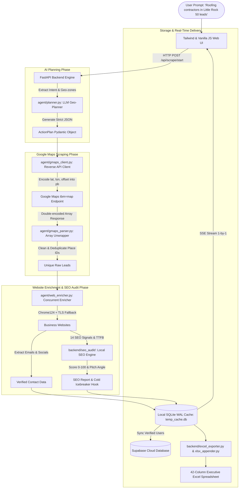

# 🗺️ Autonomous AI Google Maps Lead Generation & Local SEO Engine

> **High-Performance B2B Lead Scraping & Agency-Grade Technical SEO Audit Platform**  
> *Zero-Browser Reverse Protobuf API • Multi-Threaded Website Deep Enricher • 14-Point Local SEO Auditor • Real-Time SSE Streamer • 42-Column Executive Excel Exporter*

---

## 📌 Executive Summary (সংক্ষিপ্ত বিবরণ)

এই সিস্টেমটি একটি আধুনিক, সম্পূর্ণ অটোনোমাস (স্বয়ংক্রিয়) B2B লিড জেনারেশন ও লোকাল এসইও (Local SEO) অডিট প্ল্যাটফর্ম। 

**সাধারণ স্ক্র্যাপারদের সাথে এর মৌলিক পার্থক্য:**
1. **Zero Browser Automation (জিরো ব্রাউজার):** এটি কোনো Selenium, Playwright বা Puppeteer ব্যবহার করে **না**। ব্রাউজার ছাড়াই সরাসরি Google Maps-এর ইন্টারনাল প্রোটোকল বাফার (`tbm=map`) এন্ডপয়েন্টে `curl_cffi` (Chrome 124 TLS/JA3 Fingerprint) দিয়ে রিকোয়েস্ট পাঠিয়ে প্রতি সেকেন্ডে শত শত লিড স্ক্র্যাপ করে।
2. **AI Geo-Planner:** গুগল ম্যাপস প্রতি অনুসন্ধানে সর্বোচ্চ ১২০টি রেজাল্ট দেয়। বড় কোনো শহর (যেমন: "Dhaka", "Miami", "Dallas") দিলে AI স্বয়ংক্রিয়ভাবে শহরটিকে ৫ থেকে ২০টি ছোট সাব-জোনে (Micro-locations) ভাগ করে প্রতিটি জোনের কেন্দ্রস্থ অক্ষাংশ (`lat`) ও দ্রাঘিমাংশ (`lon`) বের করে সার্চ চালায়।
3. **Website Intelligence & Contact Enrichment:** মাল্টি-থ্রেডিং (`ThreadPoolExecutor`) দিয়ে বিজনেসের ওয়েবসাইট থেকে ইমেইল, সোশ্যাল মিডিয়া লিংক (Facebook, Instagram, LinkedIn, WhatsApp) এবং ব্যবহৃত CMS (WordPress, Wix, Shopify) বের করে আনে।
4. **Agency-Grade Local SEO Audit:** প্রতিটি ওয়েবসাইটের স্পিড (TTFB), SSL, Robots.txt, XML Sitemap, Title, H1, Schema.org Markup, NAP Consistency অডিট করে **SEO Health Score (0-100)** তৈরি করে এবং কোল্ড ইমেইলে পাঠানোর জন্য ব্যক্তিগত **AI Icebreaker Hook** লিখে দেয়।
5. **Real-time Live Streaming:** FastAPI Backend ও Server-Sent Events (SSE) দিয়ে প্রতিটি লিড পাওয়ার সাথে সাথে স্ক্রিনে লাইভ কাউন্টার ও ডেটা স্ট্রিম করে।

---

## 🏛️ System Architecture & Data Flow (সিস্টেম আর্কিটেকচার)



---

## 🔄 Step-by-Step Workflow (স্ক্র্যাপারটি যেভাবে ধাপে ধাপে কাজ করে)

### ধাপ ১: AI প্রম্পট অ্যানালাইসিস ও জিও-প্ল্যানিং (`agent/planner.py`)
- ইউজার সাধারণ ভাষায় প্রম্পট দেয়: যেমন *"Wealth Management Firms in Little Rock, Arkansas 100 lead"*.
- **ক্যাটাগরি প্রিজার্ভেশন:** ইউজারের চাওয়া নির্দিষ্ট ক্যাটাগরিকে স্ক্র্যাপার হুবহু অক্ষত রাখে (কোনো অপ্রাসঙ্গিক সিনোনিম যোগ করে লিড কোয়ালিটি নষ্ট করে না)।
- **জিও-স্প্লিটিং (Geo-Splitting):** গুগল ম্যাপসের ১২০ লিমিট বাইপাস করতে পুরো শহরকে জিপকোড বা নেবারহুড ভিত্তিক ৫ থেকে ২০টি সাব-জোনে ভাগ করে প্রতিটির সঠিক কোঅর্ডিনেট (`lat`, `lon`, `radius`) সেট করে একটি `ActionPlan` তৈরি করে।

### ধাপ ২: রিভার্স প্রোটোকল বাফার রিকোয়েস্ট (`agent/gmaps_client.py`)
- কোনো ভারী ওয়েব ব্রাউজার ছাড়াই সরাসরি Google-এর ইন্টারনাল এন্ডপয়েন্টে রিকোয়েস্ট তৈরি করা হয়:
  ```python
  # pb প্যারামিটার বিল্ডার (lon=দ্রাঘিমাংশ প্রথমে, lat=অক্ষাংশ দ্বিতীয়তে)
  pb = f"!4m8!1m3!1d{radius}!2d{lon}!3d{lat}!3m2!1i1024!2i768!4f13.1!7i20!8i{offset}!10b1!12m8!1m1!18b1!2m3!5m1!6e2!20e3!10b1!16b1"
  ```
- অফসেট লুপ (`offset = 0, 20, 40, 60, 80, 100`) চালিয়ে স্ক্রল না করেই প্রতি এলাকার সব লিড সংগ্রহ করা হয়।
- রিকোয়েস্ট পাঠাতে `curl_cffi` ব্যবহৃত হয় যা Chrome ব্রাউজারের TLS JA3 ফিঙ্গারপ্রিন্ট হুবহু অনুকরণ করে, ফলে গুগল ব্লক বা ক্যাপচা দেয় না।

### ধাপ ৩: ডাবল-এনকোডেড JSON পার্সিং (`agent/gmaps_parser.py`)
- গুগল ম্যাপস তার রেসপন্সে সিকিউরিটি প্রিফিক্স `)]}'` এবং ডাবল-এনকোডেড নেস্টেড অ্যারে পাঠায়।
- পার্সার প্রিফিক্স ক্লিন করে এবং সেফ নেভিগেশন ফাংশন `safe_get()` দিয়ে পরীক্ষিত সঠিক ইনডেক্স থেকে ডেটা আলাদা করে:
  - `b_data = item[14]`
  - **`place_id`**: `b_data[78]` (ডুপ্লিকেট দূর করার গ্লোবাল চাবি)
  - **`name`**: `b_data[11]`
  - **`categories`**: `b_data[13]`
  - **`address`**: `b_data[39]`
  - **`phone`**: `b_data[178][0][1][1][0]`
  - **`rating` & `reviews`**: `b_data[4][7]` এবং `b_data[4][8]`
  - **`website`**: `b_data[7][0]`
  - **`is_unclaimed`**: `b_data[57][1] == "Claim this business"` (আনক্লেইমড গোল্ডমাইন লিড)

### ধাপ ৪: ওয়েবসাইট ডিপ স্ক্র্যাপিং ও ডেটা এনরিচমেন্ট (`agent/web_enricher.py`)
- বিজনেসের ওয়েবসাইট স্ট্যাটাস ৩ ভাগে ক্লাসিফাই হয়:
  1. `No Website` (যাদের ওয়েবসাইট নেই)
  2. `Social Link Only` (যাদের গুগল ম্যাপসে শুধু Facebook বা Instagram পেজ দেওয়া)
  3. `Has Own Website` (যাদের আসল ওয়েবসাইট আছে)
- যাদের ওয়েবসাইট আছে, তাদের জন্য মাল্টি-থ্রেডেড ইঞ্জিনে হোমপেজ ফেচ করা হয়।
- **Cloudflare XOR Decoder & Anti-Obfuscation:** কোডে লুকানো ইমেইল বা `info [at] company [dot] com` টেক্সটকে আসল ইমেইলে রূপান্তর করা হয়।
- **Email Hygiene:** ইমেজ ফাইল (`logo@2x.png`), ওয়েব ডিজাইন এজেন্সির ফুটার ইমেইল, এবং ডামি ইমেইল ফিল্টার করে বাদ দিয়ে strictly **১টি সেরা অথেনটিক ডোমেইন ইমেইল** নির্বাচন করা হয়।
- সোশ্যাল মিডিয়া হ্যান্ডেল এবং CMS প্ল্যাটফর্ম (WordPress, Shopify, Wix, Squarespace) ডিটেক্ট করা হয়।

### ধাপ ৫: লোকাল এসইও অডিট ইঞ্জিন (`backend/seo_audit/`)
একই সিঙ্গেল ফেচ সাইকেলে ওয়েবসাইটটির ওপর ১৪টি সিনিয়র টেকনিক্যাল অডিট সম্পন্ন করা হয়:
1. **HTTP Status & Final URL:** রিডাইরেক্ট চেইন ও রেসপন্স কোড।
2. **SSL Security:** সাইটটি নিরাপদ `HTTPS`-এ চলে কি না।
3. **Honest Speed (TTFB):** সার্ভারের ফার্স্ট বাইট রেসপন্স টাইম (সেকেন্ডে)।
4. **Meta Robots:** সাইটে ভুল করে `noindex` ট্যাগ দিয়ে গুগল ইন্ডেক্স বন্ধ করা আছে কি না।
5. **Canonical Tag:** ক্যানোনিকাল ডুপ্লিকেট কনটেন্ট ইস্যু আছে কি না।
6. **Robots.txt & XML Sitemap:** সাইটম্যাপ গুগলকে সঠিকভাবে জানানো হয়েছে কি না।
7. **Title & Meta Description:** এসইও ফ্রেন্ডলি মেটা ডাটা অপটিমাইজেশন।
8. **Primary H1 Tag:** সিঙ্গেল H1 ট্যাগ আছে কি না।
9. **Image Alt Text:** ইমেজ এসইও গ্যাপ ডিটেকশন।
10. **Target City & Category Alignment:** মূল কিওয়ার্ড ও শহরের নাম Title/H1-এ আছে কি না।
11. **Schema.org JSON-LD:** LocalBusiness স্কিমা মার্কআপ চেক।
12. **NAP Consistency:** গুগল ম্যাপসের নাম, ঠিকানা ও ফোন নম্বরের সাথে ওয়েবসাইটের তথ্যের মিল আছে কি না।
13. **SEO Health Score (0-100):** সামগ্রিক স্কোর।
14. **Dynamic Cold Outreach Hook:** ক্লায়েন্টকে ইমেইল পাঠানোর জন্য কাস্টম আইসব্রেকার হুক জেনারেশন।

### ধাপ ৬: ডুয়াল-স্টোরেজ বাফার ও লাইভ স্ট্রিম (`backend/temp_store.py`)
- স্ক্র্যাপার চলার সাথে সাথে প্রতি ব্যাচের ডেটা লোকাল SQLite WAL ডাটাবেসে (`data/temp_cache.db`) সেভ হয়।
- ইউজার মাঝপথে **"Stop"** বাটন চাপলেও বা ব্রাউজার রিফ্রেশ দিলেও এ পর্যন্ত পাওয়া কোনো ডেটা হারায় না।
- ইউজার লগইন করা থাকলে ব্যাকগ্রাউন্ডে স্বয়ংক্রিয়ভাবে তার Supabase অ্যাকাউন্টে লিড সিঙ্ক হয়।

---

## 📂 Project Directory Structure (ফোল্ডার ও ফাইলের বিবরণ)

```text
Google_Map_Scraper_SaaS_Project/
├── agent/                         # Core AI Scraper & Reverse API Engine
│   ├── schemas.py                 # Pydantic ডেটা মডেল (ActionPlan, LeadItem, SubLocation)
│   ├── planner.py                 # LLM ইন্টিগ্রেশন ও মাল্টি-লোকেশন অ্যাকশন প্ল্যানার
│   ├── gmaps_client.py            # Protobuf pb বিল্ডার, অফসেট প্যাজিনেশন ও tbm=map ক্লায়েন্ট
│   ├── gmaps_parser.py            # ডাবল-এনকোডেড JSON ক্লিনার ও নির্ভুল ইনডেক্স পার্সার
│   ├── web_enricher.py            # মাল্টি-থ্রেডেড ওয়েবসাইট স্ক্র্যাপার (ইমেইল, সোশ্যাল, CMS)
│   ├── cleaner.py                 # ফোন নাম্বার ফরম্যাটার, নাম ও অ্যাড্রেস স্যানিটাইজার
│   └── pipeline.py                # মাস্টার অর্কেস্ট্রেটর (ডিডুপ্লিকেশন, ফিল্টারিং ও ব্যাচ সিঙ্ক)
│
├── backend/                       # FastAPI Server, Databases & SEO Auditor
│   ├── main.py                    # API রাউটস, CORS, রেট লিমিটার ও SSE লাইভ স্ট্রিমার
│   ├── security.py                # Google OAuth2 JWT ভেরিফায়ার ও ফেক-মেইল ব্লকার
│   ├── temp_store.py              # Local SQLite (WAL Mode) টেম্প বাফার (জিরো ডেটা লস)
│   ├── supabase_db.py             # Supabase ক্লাউড ডাটাবেস হ্যান্ডলার (লগইন ইউজারদের জন্য)
│   ├── excel_exporter.py          # মূল ২১-কলামের লিডস এক্সেল জেনারেটর
│   └── seo_audit/                 # প্রফেশনাল লোকাল এসইও অডিট ইঞ্জিন
│       ├── config.py              # এসইও ওয়েইট, স্কোরিং রুলস ও TLD হোয়াইটলিস্ট
│       ├── models.py              # SEOReport, AuditInput, AuditIssue Pydantic মডেল
│       ├── fetcher.py             # Chrome TLS ফেচার ও Robots.txt / XML Sitemap ভ্যালিডেটর
│       ├── analyzer.py            # ১৪টি এসইও সিগন্যাল চেকার (Schema, NAP, H1, Meta, City)
│       ├── scorer.py              # Health Score (0-100) ও Lead Pitch Priority ক্যালকুলেটর
│       ├── icebreaker.py          # কোল্ড ইমেইলের জন্য ডায়নামিক আউটরিচ হুক জেনারেটর
│       ├── auditor.py             # ডোমেন ক্যাশ ডিডুপ্লিকেটর ও কনকারেন্সি অর্কেস্ট্রেটর
│       ├── routes.py              # অন-ডিমান্ড /api/seo-audit ও /api/seo-audit/bulk এন্ডপয়েন্ট
│       └── xlsx_appender.py       # এক্সেল ফাইলে ২১টি এসইও কলাম যুক্ত করার স্টাইলার
│
├── frontend/                      # SaaS Web User Interface
│   ├── index.html                 # ড্যাশবোর্ড, টার্মিনাল ড্রয়ার, মোডাল ও লাইভ ফিড UI
│   ├── js/app.js                  # SSE ক্লায়েন্ট, অন-ডিমান্ড অডিট মোডাল ও রিয়েল-টাইম কন্ট্রোলার
│   └── css/                       # স্টাইলিং ও কাস্টম থিম কনফিগারেশন
│
├── tests/                         # অটোমেটেড টেস্ট স্যুট (৪৪টি টেস্ট)
│   ├── test_seo_audit.py          # এসইও সিগন্যাল ও ফলব্যাক টেস্ট
│   ├── test_seo_pipeline_integration.py # ফুল এন্ড-টু-এন্ড পাইপলাইন ইন্টিগ্রেশন টেস্ট
│   └── ...                        # কোটা, সিকিউরিটি, ফিল্টারিং ও ক্লিনআপ টেস্ট
│
├── config.py                      # গ্লোবাল এনভায়রনমেন্ট কনফিগারেশন ও টাইমআউট
├── main.py                        # টার্মিনাল থেকে স্ক্র্যাপার চালানোর CLI রানার
└── requirements.txt               # প্রজেক্টের সব ডিপেন্ডেন্সি লিস্ট
```

---

## 📊 Complete 42-Column Executive Excel Specification

যখন স্ক্র্যাপ করা ডেটা XLSX ফরম্যাটে ডাউনলোড করা হয়, তখন এটি নিচের ৪২টি অর্গানাইজড কলাম তৈরি করে:

| # | কলামের নাম | ডেটা সোর্স | বিবরণ |
|---|---|---|---|
| **1-7** | Business Name, Category, Phone Number, Emails, Website Status, Website URL, Rating | Google Maps + Enricher | বিজনেসের মূল পরিচিতি ও ভেরিফায়েড ডোমেইন ইমেইল |
| **8-12** | Reviews Count, Price Range, Unclaimed Business, Neighborhood, Full Address | Google Maps | রিভিউ সংখ্যা, লোকাল এরিয়া ও আনক্লেইমড স্ট্যাটাস |
| **13-17** | Facebook, Instagram, LinkedIn, WhatsApp, CMS / Tech | Website Enricher | সোশ্যাল মিডিয়া প্রোফাইল লিংক এবং সাইটের CMS |
| **18-21** | Latitude, Longitude, Google Maps Link, Place ID | Google Maps | জিও-কোঅর্ডিনেট ও ইউনিক ডিডুপ্লিকেশন আইডি |
| **22-26** | Final URL & HTTP Status, SSL & HTTPS Redirect, Server Response (TTFB), Indexability (Meta Robots), Canonical Tag Status | Technical SEO Audit | সাইটের এইচটিটিপি কোড, সিকিউরিটি, স্পিড ও ইন্ডেক্সাবিলিটি |
| **27-31** | Robots.txt & XML Sitemap, Extracted Title Text, Title Tag Status, Meta Description Status, Extracted Primary H1 | Technical SEO Audit | সাইটম্যাপ ভ্যালিডেশন এবং মেটা ট্যাগ অপটিমাইজেশন |
| **32-35** | H1 Tag Status, Homepage Word Count, Image Alt Text Gap, Local Keyword Status | On-Page SEO Audit | কন্টেন্ট কোয়ালিটি ও লোকাল কিওয়ার্ড অ্যালাইনমেন্ট |
| **36-39** | Schema Status, NAP Status, Google Maps Embed, GBP Category Alignment | Local SEO Audit | LocalBusiness স্কিমা এবং নাম-ঠিকানা-ফোনের মিল |
| **40-42** | **SEO Health Score**, **Lead Pitch Priority**, **AI / Dynamic Icebreaker Hook** | SEO Engine & AI | ১০০-এর মধ্যে সাইটের স্কোর, পিচ প্রায়োরিটি ও কোল্ড ইমেইল হুক |

---

## 🚀 How to Run Locally (লোকালি চালু করার নিয়ম)

### ১. ডিপেন্ডেন্সি ইনস্টল করুন
```bash
pip install -r requirements.txt
```

### ২. এনভায়রনমেন্ট ফাইল কনফিগার করুন
`.env.example` ফাইলটিকে `.env` নামে রিনেম করুন এবং আপনার API Keys দিন:
```env
GEMINI_API_KEY=your_gemini_api_key_here
GROQ_API_KEY=your_groq_api_key_here
SUPABASE_URL=your_supabase_url
SUPABASE_KEY=your_supabase_anon_key
JWT_SECRET=your_secret_key
```

### ৩. ওয়েব সার্ভার চালু করুন (Web UI & API)
```bash
uvicorn main:app --reload --port 8000
```
ব্রাউজারে গিয়ে ওপেন করুন: `http://localhost:8000`

### ৪. টার্মিনাল CLI মোডে স্ক্র্যাপ করতে চাইলে
```bash
python main.py --prompt "Roofing contractors in Little Rock, Arkansas 50 leads" --yes
```

### ৫. টেস্ট স্যুট রান করতে
```bash
python -m pytest tests/
```

---

## 🛡️ Security & Anti-Bot Philosophy
- **Zero Browser Fingerprint Discrepancy:** কোনো হেডলেস ব্রাউজার ফ্ল্যাগ নেই, ফলে ক্লাউডফ্লেয়ার বা বটের সন্দেহ তৈরি হয় না।
- **Non-blocking Cancellation:** স্ক্র্যাপার চলার সময় ইউজার স্টপ চাপলে মিলি-সেকেন্ডে ব্যাকগ্রাউন্ড থ্রেডগুলো রিলিজ হয়।
- **IP Quota & Temp Buffer:** অ্যানোনিমাস ইউজারদের প্রতি ২৪ ঘণ্টায় সর্বোচ্চ ১,০০০ ফ্রি লিডের কোটা থাকে এবং লোকাল বাফারে সংরক্ষিত থাকে।
